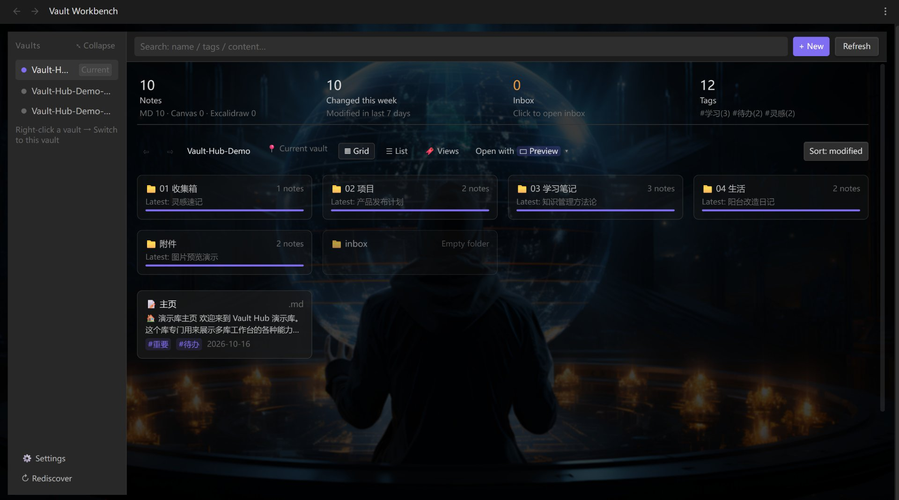
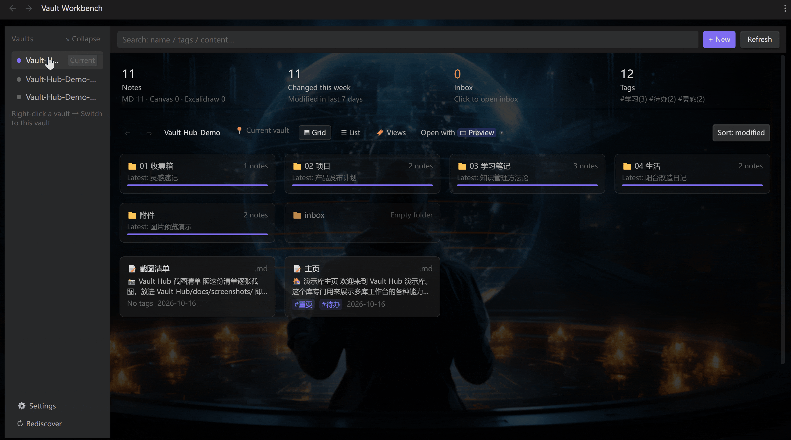
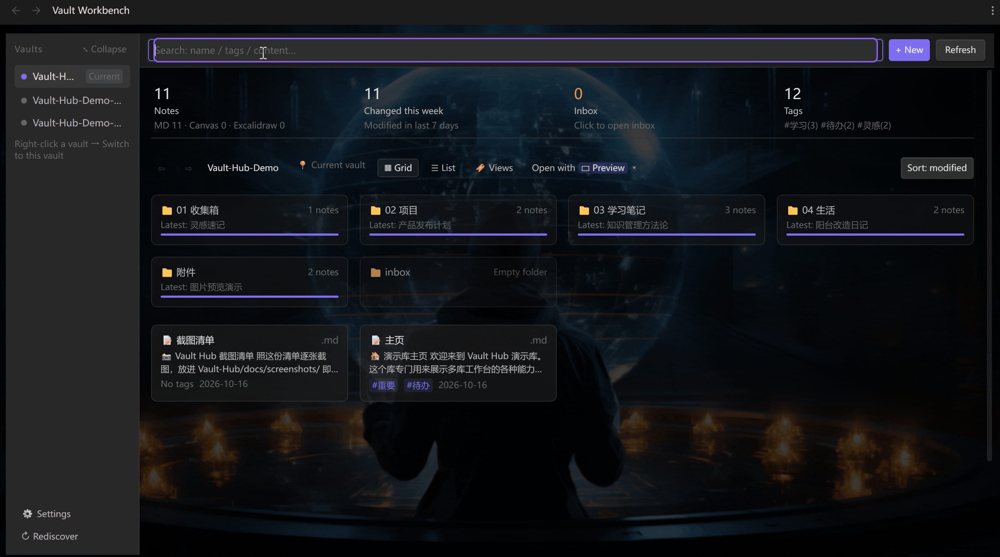
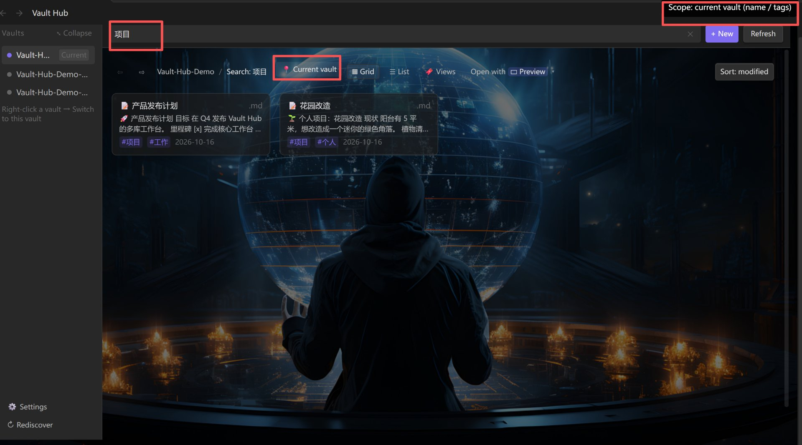
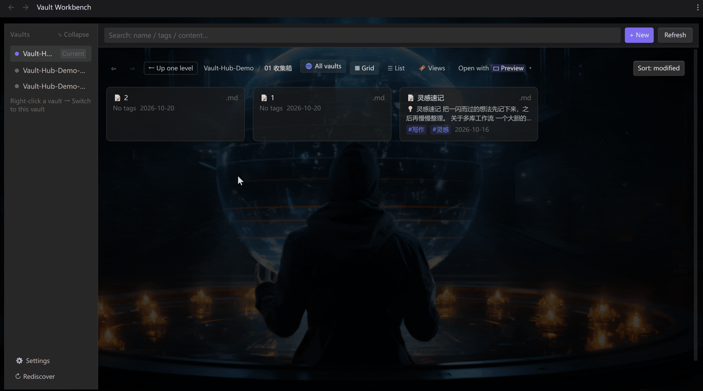
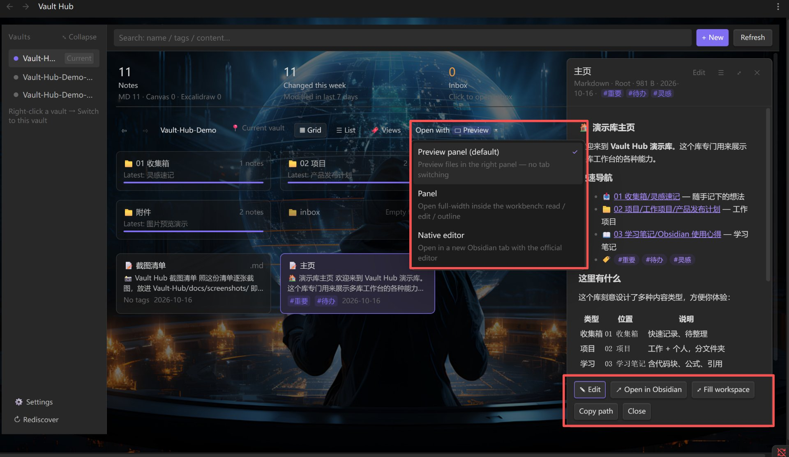
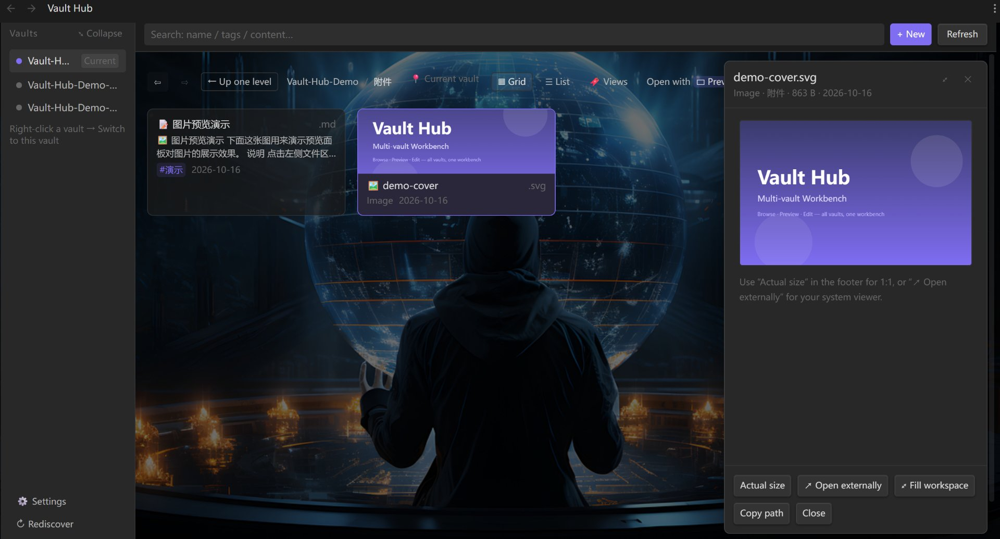
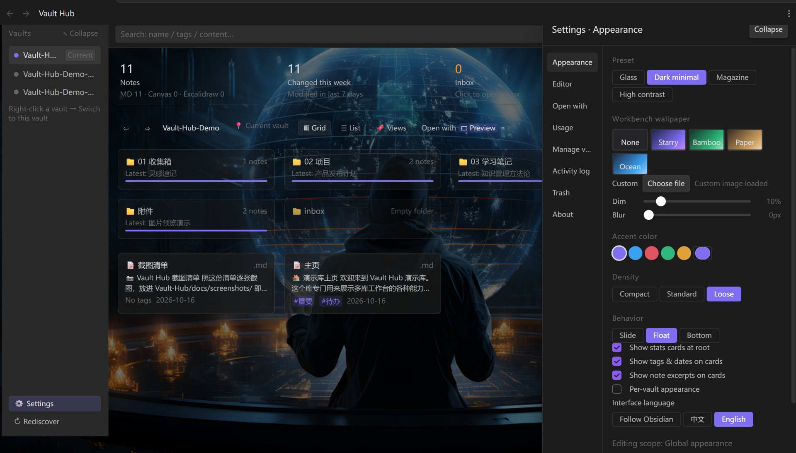

# Vault Workbench | Multi-Vault Workbench

> A polished workbench UI for Obsidian.
> Browse, preview and edit every vault on this machine from one workbench —
> no more switching windows. Each vault stays fully isolated, and the plugin
> installs itself into the target vault when you switch.

[English](README_EN.md) | [中文文档](README_ZH.md)

---

## ✨ Features

**Not a search box, not a popup — a whole workbench:**

| Area | What you do here |
| --- | --- |
| **Left · Vaults** | Every vault on this machine in one column. Click to switch. Collapsible, hideable, renameable |
| **Middle · Files** | Folder drill-down + breadcrumbs, grid / list views, search & sort, **multi-select batch actions** |
| **Right · Preview** | Read, edit, outline. Images / PDF / audio / video / text all handled |

- **Four dashboard cards** — a permanent overview strip at the top of the file area, counting the **current vault only**: **total notes** (`MD n · Canvas n · Excalidraw n`), **modified this week**, **inbox**, and **tags**. **Click a card to filter** — click 本周修改 to see the last 7 days, click 标签库 for a tag panel with multi-select intersection. Search term, folder, tag and time window all **stack with AND**; the inbox folder name is configurable and gets created for you on first click

- **One place for all vaults** — no window switching, no reloading. Browsing another vault feels like browsing another folder. Empty folders show up too (the folder list comes from the vault's real directory tree, not guessed from notes)

  

- **Cross-vault full-text search** — flip 「📍 Current」 to 「🌐 All vaults」 in the toolbar and you're searching the **body text of every vault**. Each result shows which vault it's from, plus a **snippet with the match highlighted**. Click to open it right there. The index is built locally, and only when you actually search all vaults

  All vaults (full body text, 8 hits):

  

  Current vault (names / tags, lightweight):

  
- **Right-click a vault → Switch to this vault** — the plugin **installs itself into that vault first**, then jumps. You land in the same workbench you left
- **Clear permissions** — full access in the current vault; in other vaults you can **read, edit, and also create / rename / delete**. Renaming **repairs that vault's `[[wikilinks]]` automatically**; deleting moves the file to that vault's `.trash` and can be undone
- **Copy across vaults** — multi-select → 「Copy to…」 sends notes to another vault while the **original stays put**. **No cross-vault move**: moving breaks links, copying doesn't
- **One trash for all vaults** — anything you delete in another vault shows up in **Settings → Trash**, remembering its **original path**, so restoring puts it back where it was (survives an Obsidian restart)
- **Rubber-band select & blank-space menu** — **drag on empty space to box-select** (hold `Ctrl` to add); **right-click empty space** for new note / select all / switch view and more
- **Built-in editor** — live preview (click to edit in place), split view (synced scrolling), or raw source. Right-click anywhere for the full formatting menu

  

- **Three open modes** — side preview (default) / panel / native editor, switchable anytime

  

  The preview panel handles images / PDF / audio / video each in its own way:

  

- **Looks are configurable** — wallpapers, accent color, density, **a separate look per vault**. The interface itself is built on Obsidian's own CSS variables, so it follows your theme instead of shipping a separate skin

  
- **Bilingual UI** — the interface **follows Obsidian's own language** by default. To pin it, pick 中文 or English under **⚙ Settings → General → Interface language**; it applies instantly, no restart. Anything not yet translated shows its **raw key** rather than a stray Chinese string, so gaps are easy to spot

---

## 📦 Install

Settings → Community plugins → turn off Restricted mode → Browse → search **Vault Workbench** → install & enable.

Manual install, BRAT and troubleshooting: see **[Install guide](docs/INSTALL.md)**.

---

## 🚀 Quick start

1. Click the grid icon in the left ribbon (or run "Open Vault Workbench" from the command palette)
2. All your vaults are listed on the left; the one marked `当前` is the active one. Click to browse another
3. Want to edit there? → **right-click that vault → Switch to this vault** (the plugin is installed first, then it jumps)

> Shortcuts, editor details, the full context-menu reference and every setting live in
> **⚙ Settings → Usage** inside the plugin — that's the up-to-date reference.

---

## 📌 Why run multiple vaults?

Multiple vaults aren't a compromise — they're a deliberate design choice:

- 🔍 **Query isolation** — Dataview, tags, global search and task queries never leak between projects. Doing the same in one vault means maintaining a pile of filter rules
- 🔄 **Independent sync & publish** — each vault can have its own cloud sync / Git / blog publishing setup. (This comes from the multi-vault architecture itself: **the plugin never syncs anything and never merges your vaults**, so your existing setup is untouched)
- ⚡ **Performance isolation** — archived vaults don't sit in the index; the active vault stays fast
- 🔒 **Privacy isolation** — contracts, AI source material and public content in separate vaults; you can give AI access to one vault only
- 🧪 **Independent configuration** — each vault keeps its own plugin set and theme; a playground vault can't pollute your real one
- 🤝 **Delivery isolation** — hand a client one project vault without shipping everything else

> Full write-up (11 benefits): **[Multi-vault architecture (zh)](docs/多库架构设计思考.md)**

---

## ⚠️ Limitations

- **Desktop only** — relies on Node file access and the `obsidian://` protocol
- The **first** time you enter a vault you must turn off **Restricted mode** once — that's Obsidian's security design, no plugin can preset it. One click, permanent
- The built-in editor is hand-rolled: no wikilink autocomplete or other CodeMirror features (one click jumps to the native editor)
- Cross-vault search is **substring matching** (case-insensitive; Chinese is matched without word segmentation), not semantic search. The first search in a vault builds its index, so it's a bit slower once — after that it's incremental

---

## 🔒 Files outside your vaults

Browsing other vaults means reading outside the current one. All of this happens **locally — no network, no telemetry**:

| File | Access | Why |
| --- | --- | --- |
| Obsidian's `obsidian.json` | read | Discover which vaults exist on this machine |
| Notes & attachments in other vaults | read + write + create / rename / delete | Browse, edit and restructure without switching (atomic writes; deletes go to that vault's `.trash` and can be undone) |
| `.trash/` in other vaults | write | Deleted files are moved here first — never removed outright |
| `.obsidian/plugins/vault-workbench/` in the target vault | write | Install the plugin there before switching |
| `.obsidian/community-plugins.json` in the target vault | read/write | Enable the plugin there |
| `vault-workbench/vaults.json` on this machine | read/write | Shared list of vaults |
| `vault-workbench/index/*.json` on this machine | read/write | **Cross-vault search index** (plain text with markup stripped, capped at 3000 chars per note). Deleting it never touches your notes — it's rebuilt on the next search |

Self-install only happens in folders that **already are vaults** (they contain `.obsidian`). It never turns a random folder into a new vault.

---

## 🔗 More

[中文文档](README_ZH.md) · [Multi-vault architecture (zh)](docs/多库架构设计思考.md) ·
[Architecture (zh)](docs/ARCHITECTURE.md) ·
[Changelog](CHANGELOG.md)

## License

[MIT](LICENSE) © 2026 Bevis23
