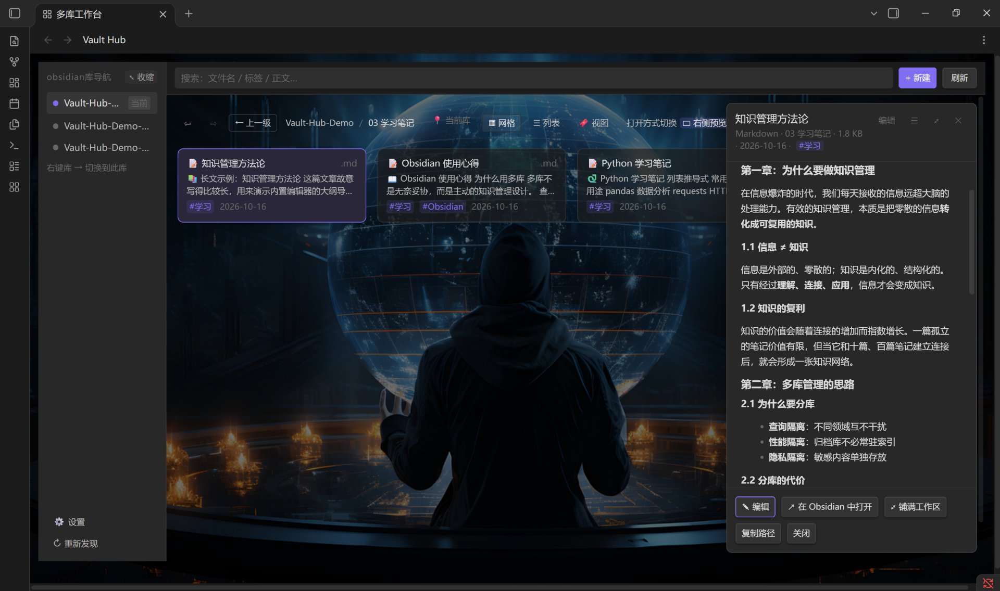
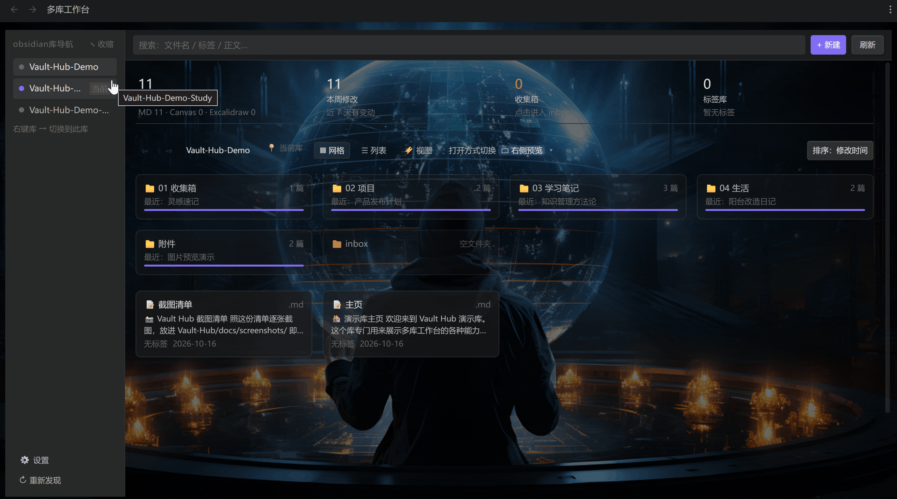
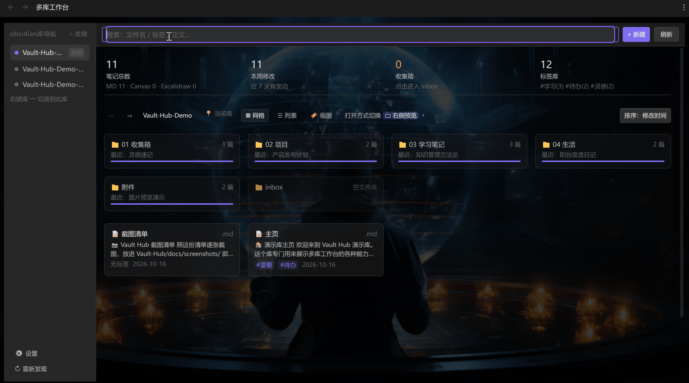
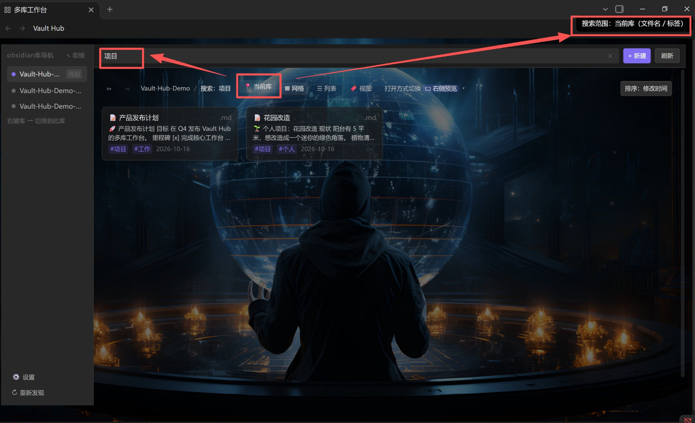
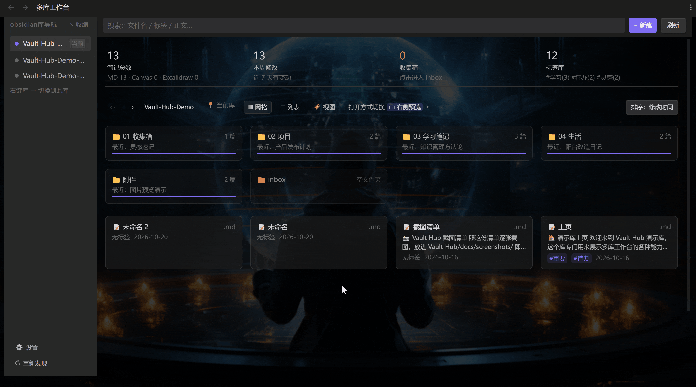
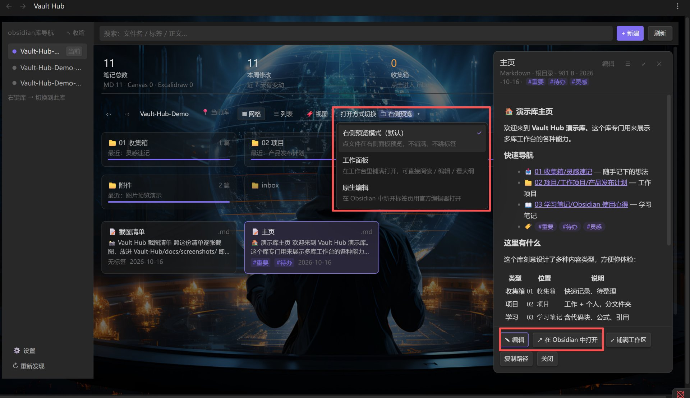
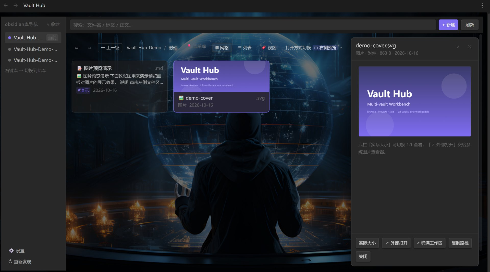
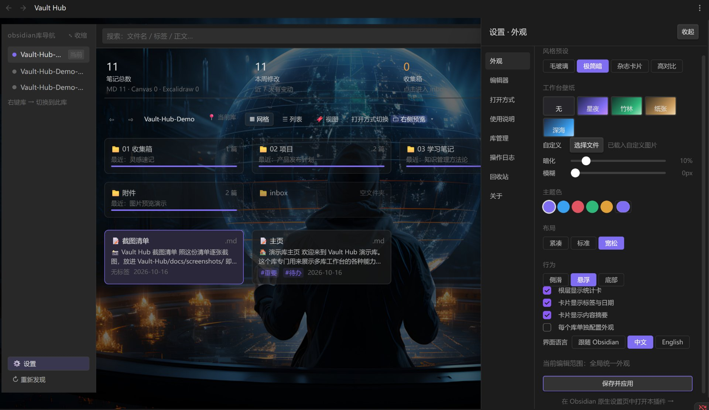

# Vault Workbench｜多库工作台

> 🇨🇳 给 Obsidian 装上精美工作台 UI：在一个工作台浏览、预览、编辑本机所有 Obsidian 库，无需反复切换窗口。各库保持完全隔离，切换库时自动部署本插件。

---

## ✨ 核心特性

**不是一个搜索框，也不是一个弹窗 —— 是一整块工作台**：

| 区域 | 你在这干嘛 |
| --- | --- |
| **左 · 库导航** | 本机所有 Obsidian 库一屏列完，点一下就翻过去；可展开 / 收缩、可隐藏、可起别名 |
| **中 · 文件区** | 文件夹钻取 + 面包屑回退、网格 / 列表双视图、搜索与排序、**多选批量操作** |
| **右 · 预览面板** | 看笔记、改笔记、看大纲；图片 / PDF / 音视频 / 文本各有处理 |

- **仪表盘四卡片** —— 文件区顶部常驻 **笔记总数 / 本周修改 / 收集箱 / 标签库** 四张卡片，
  只统计**当前库**。**点卡片即筛选**：点「本周修改」看近 7 天改动，点「标签库」进标签面板多选取交集。
  搜索词、文件夹、标签、时间窗**按 AND 叠加**；收集箱文件夹名可自定义，第一次点没建也会自动建好

- **多库统一导航** —— 不切窗口、不重载，翻别的库跟翻一个文件夹一样；
  空文件夹也列得出来（直接读库的目录树，不靠笔记反推）

  

- **跨库全文搜索** —— 工具条点「📍 当前库」切成「🌐 所有库」，搜的就是**全部库的正文**：
  结果左边标着是哪个库，下面是**命中片段 + 关键词高亮**，点一下直接打开。
  索引建在本机，只在真的按「所有库」搜时才建

  按所有库搜（正文全文，命中 8 篇）：

  

  按当前库搜（文件名 / 标签，轻快）：

  
- **右键库 → 切换到此库** —— 切库前会**先把本插件装进那个库再跳**，
  所以切过去照样有工作台（这是目前独一份的能力）
- **权限清楚** —— 当前库全权限；别的库**能看、能改正文，也能新建 / 重命名 / 删除**
  （重命名会**自动修好这个库里的 `[[双链]]`**，删除进该库的 `.trash` 且可撤销）
- **跨库复制** —— 多选后「复制到…」把笔记搬到另一个库，**原件留在原处**。
  **不做跨库移动**：移动必然断链，复制不会
- **回收站一处看全** —— 在别的库删掉的东西都能在「设置 → 回收站」里看到，
  连**原来的路径**都记得，还原就回到原处（重启 Obsidian 也不丢）
- **框选与空白右键** —— 文件区空白处**拖一下就框选**（按住 `Ctrl` 是追加）；
  空白处**右键**有新建 / 全选 / 切换视图等操作
- **内置编辑器** —— 即时渲染单画布（点哪改哪）、双栏分屏（滚动同步）、纯源码；
  正文里右键唤起完整格式菜单

  

- **三种打开方式** —— 右侧预览（默认）/ 工作面板 / 原生编辑，随时切换

  

  预览面板对图片 / PDF / 音视频各有处理：

  
- **外观个性化** —— 壁纸、主题色、布局密度，**每个库可以单独配一套**；
  界面本身跟随 Obsidian 主题（原生变量），换主题即换肤，不做独立皮肤

  
- **中英双语** —— 界面默认**跟随 Obsidian 的语言**；想固定就在
  **⚙ 设置 → 通用 → 界面语言**里选「中文」或「English」，切完立刻生效、不用重启。
  万一有漏翻的条目，会**原样显示 key** 而不是留一段中文，方便一眼定位

---

## 📦 安装

设置 → 第三方插件 → 关闭安全模式 → 浏览 → 搜 **Vault Workbench** → 安装并启用。

手动安装与 BRAT 见 **[安装说明](docs/安装说明.md)**。

---

## 🚀 三步上手

1. 点左侧 ribbon 的「布局网格」图标（或命令面板搜「打开多库工作台」）
2. 左边列出你所有的库，带 `当前` 标记的是正在用的那个 —— 点库名切换浏览
3. 想切过去编辑 → **右键那个库 → 切换到此库**（会先装好插件再跳）

> 快捷键、编辑器细节、右键菜单全表、设置项说明 → 见插件内 **⚙ 设置 → 使用说明**，
> 那里才是最新最全的一份。

---

## 📌 为什么用多库架构？

多库不是无奈妥协，而是**主动的知识管理设计**：

- 🔍 **查询隔离** —— Dataview、标签、全局搜索、任务查询互不污染；
  单库要做到同等隔离，得写一堆过滤规则去维护
- 🔄 **独立同步 & 发布** —— **每个仓库可单独配置云同步 / Git / 博客发布**
  （这是多库架构自带的优势：本插件**不参与同步、也不合并你的库**，
  所以你原有的同步与发布方案完全不受影响）
- ⚡ **性能隔离** —— 归档项目库不必常驻索引，活跃库保持轻快
- 🔒 **隐私隔离** —— 合同财务 / AI 素材 / 公开内容分库存放，可限制 AI 只访问素材库
- 🧪 **独立配置** —— 每个库可以有自己的插件集与主题；折腾插件的试验库不会污染正式库
- 🤝 **交付隔离** —— 给客户 / 同事只交付那一个项目库，不附带其他笔记

> 详细理念与完整优势（11 条）：**[多库架构设计思考](docs/多库架构设计思考.md)**

---

## ⚠️ 已知限制

- 仅**桌面端**（依赖 Node 文件读写与 `obsidian://` 协议）
- 每个库**第一次**进要手动关一次「受限模式」—— Obsidian 的安全设计，插件无法预置，关一次永久生效
- 内置编辑器是自研的，没有双链自动补全等 CodeMirror 能力（可一键跳原生编辑）
- 跨库搜索是**子串匹配**（不分词的中文子串、大小写不敏感的英文），不是语义搜索；
  第一篇建索引时会稍慢一次，之后走增量

---

## 🔒 会碰到的库外文件

跨库浏览必须「看得到库之外的文件」，这里一次说清楚。**全部在本机进行，不联网、无遥测**：

| 文件 | 动作 | 为什么 |
| --- | --- | --- |
| Obsidian 的 `obsidian.json` | 读 | 自动发现本机有哪些库（按系统定位配置目录） |
| 其他库的笔记与附件 | 读 + 改 + 建 / 改名 / 删除 | 不切库就能浏览、编辑与改结构（原子写；删除进该库的 `.trash`，可撤销） |
| 其他库的 `.trash/` | 写 | 在别的库删除的文件先挪到这里，不是直接删 |
| 目标库的 `.obsidian/plugins/vault-workbench/` | 写 | 切库前把本插件装过去 |
| 目标库的 `.obsidian/community-plugins.json` | 读写 | 在那边启用本插件 |
| 本机 `vault-workbench/vaults.json` | 读写 | 跨库共享的库清单 |
| 本机 `vault-workbench/index/*.json` | 读写 | **跨库全文搜索的索引**（存的是去语法后的纯文本，每篇最多 3000 字），删掉不影响笔记，下次搜索会重建 |

自部署只会在**已经是 Obsidian 库**（里面有 `.obsidian`）的文件夹里进行，不会凭空造出一个新库。

---

## 🔗 更多

[English](README.md) · [安装说明](docs/安装说明.md) · [多库架构设计思考](docs/多库架构设计思考.md) ·
[架构设计](docs/ARCHITECTURE.md) ·
[更新日志](CHANGELOG.md) · [参与开发](CONTRIBUTING.md)

## 许可

[MIT](LICENSE) © 2026 Bevis23
